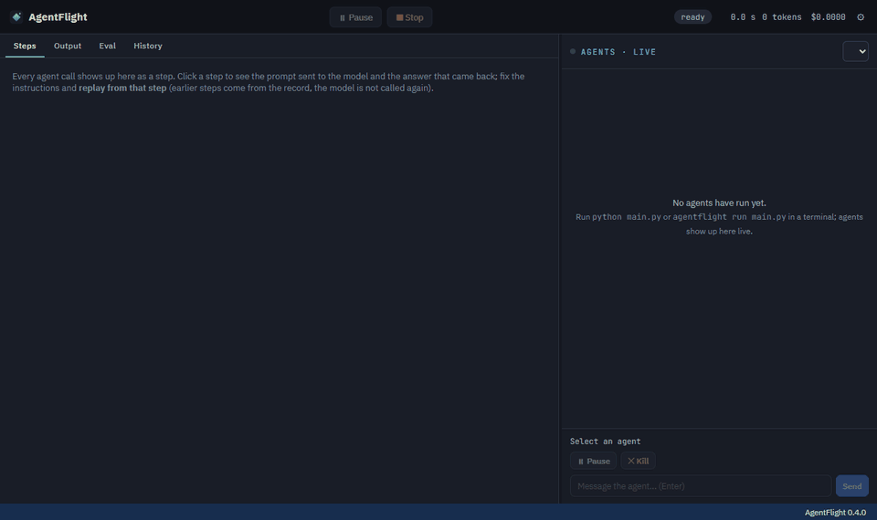
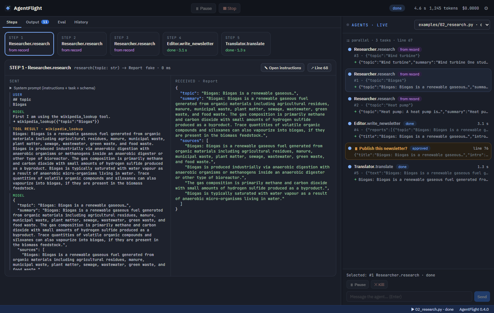
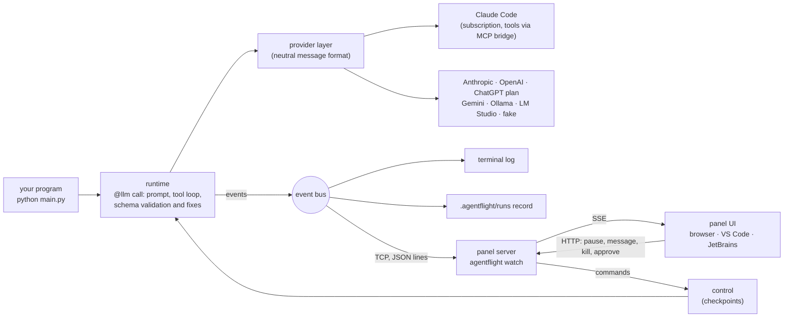

# AgentFlight

[](https://github.com/AkiCagkan/agentflight/actions/workflows/ci.yml)

[](LICENSE)

**Debug LLM agents like code, right inside VS Code.**

AgentFlight is a VS Code extension plus a small Python library. You write agents in plain Python; the extension
shows every agent call live next to your terminal, lets you step in while it runs, replays any step from a
record, and runs your evals. Like a flight recorder for your agents, with the controls in your hands.



<sub>The AgentFlight panel while `examples/02_research.py` runs on a local 4B model (LM Studio); recorded with
`scripts/record_demo.py`.</sub>

## What you get in VS Code

- **The AgentFlight panel next to your terminal**: every agent call of every running program, live: tool calls,
  the streamed answer, format errors and their fixes, tokens and cost.
- **▶ Run with AgentFlight** above every agent class and **✓ Run eval** above every eval (CodeLens).
- **Running lines highlighted** in the editor; a line waiting for a human approval is marked and a notification
  pops up.
- **Step in**: pause or kill an agent, send it a message, approve, edit or reject a value
  (`require_approval`) before the program continues.
- **Replay from any step**: every run is recorded; fix a prompt and re-run from step 4 while steps 1-3 come from
  the record, without calling the model again.
- **Evals next to the code**, measured statistically ("9 out of 10 tries must pass"), with an optional model judge.
- **Model-name completion** inside `model = "` and `agentflight check` on save (Problems view); links in the panel
  open the file at the line.
- **Your own subscription** (ChatGPT plan, Claude Pro/Max through Claude Code), API keys (Anthropic, OpenAI,
  Gemini) or local models (Ollama, LM Studio); different agents can use different providers in one program.

The extension also works in **Cursor** and VSCodium. The same panel opens in a browser (`agentflight watch`), and
there is an experimental JetBrains plugin.

> **Status: alpha (0.4.0).** Not on PyPI or the VS Code Marketplace yet; install from the
> [releases](https://github.com/AkiCagkan/agentflight/releases) or from source. The library has no runtime
> dependencies besides the Python standard library.

## Quick start

1. Install the library (Python 3.11+):

   ```bash
   git clone https://github.com/AkiCagkan/agentflight.git && cd agentflight
   pip install -e .
   ```

2. Install the extension: download `agentflight-vscode-0.4.0.vsix` from the
   [latest release](https://github.com/AkiCagkan/agentflight/releases/latest) (or build it with
   `python scripts/build_vsix.py`), then:

   ```bash
   code --install-extension agentflight-vscode-0.4.0.vsix      # Cursor: cursor --install-extension ...
   ```

3. Open the `examples/` folder in VS Code, open `02_research.py` and click **▶ Run with AgentFlight**. The panel
   opens next to the terminal and the three researchers start working.

Without an account or API key, `model = "auto"` falls back to an offline `fake` model that builds schema-shaped
answers from the input text, which is enough to try the panel, approvals, recording and replay. To use real
models, connect one of:

```bash
agentflight login chatgpt        # "Sign in with ChatGPT" in the browser; billed to your ChatGPT plan
agentflight login claude         # Claude Code's own login; Claude agents then run on your Claude subscription
# or set ANTHROPIC_API_KEY / OPENAI_API_KEY / GEMINI_API_KEY, or start Ollama / LM Studio
agentflight models               # what is available and which route each model takes
```

Not using VS Code? Run `agentflight watch` to open the same panel in a browser, then start your program from any
terminal (`python main.py`); it shows up in the panel.

## The panel

`agentflight watch` starts a local server and opens the panel. Every AgentFlight program started while it runs
(`python main.py`, `agentflight run main.py`, from any terminal or editor) finds it through `~/.agentflight/panel.json`,
connects, streams its events and is recorded. Without a panel a program prints a compact live log to the
terminal instead (`AGENTFLIGHT_PANEL=0` turns the connection off).

| | |
|---|---|
| **Agents · Live** | The call tree of the selected run: parallel groups, nested agents (an agent called from another agent's tool), tool calls, the streamed answer, format errors and fixes, model fallbacks, cost or "subscription" |
| **Step in** | Pause / resume / kill one agent (its sub-agents follow) or the whole program; send a message to a running agent |
| **Approvals** | `require_approval(value, "question")` waits here: Approve, Edit (re-validated against the type) or Reject |
| **Steps** | Each agent call is a step: the exact system prompt and messages sent, the answer received, "Replay from this step", links to the source line and the instructions file |
| **Output · Eval · History** | The program's stdout/stderr, eval results, earlier runs of every project that connected |
| **Settings** | Connect ChatGPT / Claude, API keys (DPAPI-encrypted on Windows), account-vs-key priority |



### Other editors

| Editor | Install | What you get |
|---|---|---|
| **Browser** | `agentflight watch` | The same panel at http://127.0.0.1:7790 |
| **PyCharm, IntelliJ IDEA** and other JetBrains IDEs (2024.1+), experimental | `agentflight-jetbrains-0.4.0.zip` from the releases (or `python scripts/build_jetbrains.py`) → Settings › Plugins › ⚙ › *Install Plugin from Disk…* | An *AgentFlight* tool window with the panel; *Run with AgentFlight* / *Run AgentFlight Evals* actions; links open files |

## Writing agents

An AgentFlight program is ordinary Python. Your code decides the flow; the model fills typed gaps:

```python
from agentflight import Agent, Eval, Schema, field, llm


class Summary(Schema):
    title: str = field("The main topic, at most 8 words")
    bullets: list[str] = field("Key points", min=2, max=5)


class Summarizer(Agent):
    """prompts/summary.md"""              # instructions: a file path or the text itself
    model = "claude-opus-5-5"

    @llm
    def summarize(self, text: str) -> Summary: ...     # no body: the model does the work


class SummaryRules(Eval, target=Summarizer.summarize):
    inputs = "data/*.txt"
    threshold = 0.9                                     # 9 out of 10 samples must pass

    @staticmethod
    def check(input, result):
        assert len(result.title.split()) <= 8


if __name__ == "__main__":
    summary = Summarizer().summarize(open("data/biogas.txt", encoding="utf-8").read())
    print(summary.title, summary.bullets)
```

`summarize` returns a real `Summary` or raises `SchemaError`; when the model's answer does not match the type,
the validation errors are sent back and the model is asked to fix it. A fuller agent:

```python
from agentflight import (Agent, Eval, Schema, field, llm, mcp_server, parallel, parallel_map,
                         require_approval, tool)


@tool
def wikipedia_lookup(topic: str) -> str:
    """Fetches the summary of an English Wikipedia article.

    topic: article title, e.g. "Biogas"
    """
    ...


class Researcher(Agent):
    """prompts/researcher.md"""
    model = "claude-opus-5-5"              # default: the project's model in agentflight.toml
    tools = [wikipedia_lookup, *mcp_server("npx -y @modelcontextprotocol/server-filesystem .")]
    budget = 0.30                          # USD per run for this agent (API-key routes)
    temperature = 0                        # where the route supports it
    retries = 2                            # format-fix attempts when the answer breaks the schema
    max_turns = 12                         # tool-loop limit
    memory = False                         # True: later calls on the object see the earlier conversation

    @llm
    def research(self, topic: str) -> Report: ...

    @llm
    async def research_async(self, topic: str) -> Report: ...      # awaitable

    def compare(self, a: str, b: str) -> list[Report]:               # ordinary method, plain Python
        return list(parallel(lambda: self.research(a), lambda: self.research(b)))


newsletter = require_approval(newsletter, "Publish this newsletter?")   # the program waits here
labels = parallel_map(Classifier().classify, reviews)
```

- The docstring of an `@llm` method is sent as the task of that call; its parameters are the input.
- Return types: `Schema` classes with `field(description, min=, max=, pattern=, default=, example=)`,
  **Pydantic models**, and plain types (`str`, `int`, `list[T]`, `dict[str, T]`, `Literal[...]`, `T | None`,
  unions, nested schemas).
- Tool schemas come from the signature (Pydantic parameters work too); arguments are validated before the tool
  runs, and a failing tool is reported to the model instead of crashing the program.
- Evals: `inputs` (a list or a glob of files) or `examples` (`(input, expected)` pairs), `repeat`, `threshold`,
  `check(input, result[, expected])` (assert, return a bool or a 0-1 score), `judge = "criterion"` for a model
  judge. `agentflight eval main.py` loads the definitions without running the program's main code.

## Models and accounts

| Model name | Route |
|---|---|
| `claude-opus-5-5`, `claude-sonnet-5-5`, `claude-haiku-5-5`, `claude-fable-5-1` | Claude Code (subscription) or `ANTHROPIC_API_KEY` |
| your ChatGPT account's models (`agentflight models`), `gpt-5`, `gpt-5-mini` | ChatGPT plan or `OPENAI_API_KEY` |
| `gemini-flash-latest`, `gemini-pro-latest` | `GEMINI_API_KEY` |
| `openai/<model>` | OpenAI API or a compatible server at `OPENAI_BASE_URL` |
| `lmstudio/<model>`, `ollama/<model>` | local, no key |
| `fake`, `fake:bad` | offline fake model (`fake:bad` breaks the format on the first try) |

`model = "auto"` picks the first connected account or key, skips a route that fails with an access error,
then a running Ollama / LM Studio model, then `fake`. With both an account and a key for a provider, the
account is used first (configurable). Force a route with a prefix: `claude-code/…`, `anthropic/…`,
`chatgpt/…`, `openai/…`. Subscription calls show **subscription** instead of a cost and do not count against
budgets. `agentflight run --model M` or `AGENTFLIGHT_MODEL=M` overrides the model of every agent.

## Recording and replay

```bash
agentflight runs                                                   # recorded runs of this project
agentflight run main.py --replay 20261010-142000-ab12              # entirely from the record
agentflight run main.py --replay 20261010-142000-ab12 --step 4     # steps 1-3 from the record, live from step 4
```

Runs are recorded under `.agentflight/runs/<id>/` (always with `agentflight run`, and for any program while the panel is
open): the event stream, and for each call the prompt sent, the answer, tokens and cost. A replayed call is
matched by a key over agent, method, signature, system prompt, input, model, tools and memory, so a call
whose prompt you changed runs live while the unchanged ones come from the record.

| Layer | What it gives | Guarantee |
|---|---|---|
| Schema | the answer always has the declared shape | exact |
| Fixed model, `temperature = 0`, `seed` | content is mostly the same | high, not exact |
| Record and replay | runs repeat exactly from the record | exact |
| Eval | "passes in 9 of 10 tries" | statistical |

## How it works



Some design decisions:

- **Line-accurate live view.** Every agent call records the first stack frame that belongs to the user's
  program, so the panel and the VS Code extension can point at (and highlight) the exact line that is running.
- **Typed answers that hold.** The return type becomes a JSON schema in the prompt and, where the provider has a
  native schema mode, a "strict" variant of it (limits such as `maxLength` move into descriptions, since native
  modes reject them). The answer is then validated locally against the full type, and errors are sent back with
  their paths (`items[1].qty: expected int, got 'many'`).
- **Cooperative control.** Pause, kill and messages are checked at safe points (before each turn, on every
  streamed token, before each tool call). Calls form a tree through `contextvars`, so pausing an agent also
  pauses the sub-agents its tools started, including those running in `parallel` threads.
- **Local and locked down.** The panel listens on 127.0.0.1 only; programs authenticate to it with a random
  token from `~/.agentflight/panel.json`; the HTTP server checks the `Host` header (DNS rebinding) and requires the
  token on every POST.
- **Subscriptions without touching credentials.** Claude agents run through the unmodified `claude` program in
  `-p` stream-JSON mode with its own tools disabled; the agent's tools are offered through a local MCP server
  protected by a random token, so tool calls still go through AgentFlight (visible, approvable, stoppable). AgentFlight never
  reads or stores Claude credentials. The ChatGPT sign-in is OAuth with PKCE and dynamic client registration on
  a loopback callback; the ID token's RS256 signature is verified with the standard library only.

| Path | |
|---|---|
| `agentflight/agents.py` | `Agent`, `@llm`: prompt, tool loop, format fixes, events, replay lookup |
| `agentflight/schema.py` | `Schema`, Pydantic support, JSON schema, validation, parsing model output |
| `agentflight/tools.py`, `agentflight/mcp_bridge.py` | tools, MCP client; MCP server that exposes tools to Claude Code |
| `agentflight/runtime.py`, `agentflight/events.py`, `agentflight/recording.py` | run state, event bus, live control, records and replay |
| `agentflight/evals.py`, `agentflight/flow.py` | evals and the model judge; `parallel`, `require_approval` |
| `agentflight/providers/` | provider adapters and model routing |
| `agentflight/accounts/` | Sign in with ChatGPT; Claude Code status and login |
| `agentflight/runner.py`, `agentflight/checker.py`, `agentflight/cli.py` | running programs and evals, static checks, the `agentflight` command |
| `agentflight/panel/` | panel server (HTTP + SSE + runner socket) and the web UI |
| `editors/vscode/`, `editors/jetbrains/` | editor extensions |

## Commands

| Command | |
|---|---|
| `agentflight run FILE [--model M] [--approve auto] [--budget USD] [--replay RUN [--step N]] [-- args]` | run a program |
| `agentflight check FILE ... [--json]` | static checks without running (unknown types, missing instruction files, wrong eval targets, misspelled settings, wrong argument counts...) |
| `agentflight eval FILE [--name E] [--model M] [--json report.json]` | run the evals |
| `agentflight watch [--port 7790] [--no-browser] [--stop]` | the panel |
| `agentflight login chatgpt\|claude`, `agentflight logout …`, `agentflight accounts`, `agentflight models` | accounts and models |
| `agentflight new DIR`, `agentflight runs` | new project, recorded runs |

Project settings live in `agentflight.toml`:

```toml
[project]
name = "my-project"
model = "auto"         # default model of every agent

[budget]
total = 1.0            # USD per run (API-key routes)

[prices]               # optional price overrides (USD per 1M tokens: input, output)
"gemini-flash-latest" = [0.30, 2.50]
```

## Development

```bash
pip install -e ".[dev]"
python -m unittest discover -s tests -t .     # 118 tests; offline, no keys or accounts needed
python tests/panel_browser_test.py            # the panel end to end in a real browser (Playwright)
python -m unittest tests.vscode_unit_test     # the VS Code extension against a real panel
ruff check .
```

The tests run the real runtime against the offline fake model and against fake servers: a fake OpenAI login
server that signs real RS256 ID tokens, a fake `claude` executable (`tests/fake_claude.py`), fake
OpenAI / Gemini / Ollama endpoints and a stdio MCP server. `tests/test_edge_cases.py` covers malformed answers,
failing tools and providers, broken files on disk, interrupted input and panels that disappear mid-run. CI runs
the suite on Linux, Windows and macOS with Python 3.11-3.13.

## Related work

AgentFlight combines ideas that exist separately; it is not the first tool for any one of them:

- **Typed LLM functions**: [Pydantic AI](https://ai.pydantic.dev/), [Instructor](https://python.useinstructor.com/),
  [Marvin](https://www.askmarvin.ai/), [magentic](https://magentic.dev/) and the recent
  [thunc](https://github.com/Eltarras/thunc) turn typed signatures into model calls.
- **Tracing and evals**: [Langfuse](https://langfuse.com/), [Arize Phoenix](https://phoenix.arize.com/),
  [LangSmith](https://www.langchain.com/langsmith), [promptfoo](https://www.promptfoo.dev/),
  [DeepEval](https://github.com/confident-ai/deepeval).
- **Interactive debugging**: [LangGraph](https://docs.langchain.com/oss/python/langgraph/use-time-travel)
  (checkpoints, time travel, interrupts) and Microsoft's
  [AI Toolkit Agent Inspector](https://code.visualstudio.com/docs/intelligentapps/agent-inspector) for VS Code
  (agents built with Microsoft Agent Framework).

AgentFlight's angle is to put these in one local tool for plain Python code: no graph to define, no account or
hosted service, the panel inside the editor you already use, intervention and step replay on any program, and
subscriptions as well as API keys.

## Known limitations

- Agent calls run on threads; `async` methods await them with `asyncio.to_thread`.
- On the Claude Code route each agent call starts a `claude` process (a few hundred ms); `temperature` and
  `seed` do not apply there, and subscription usage limits apply.
- The ChatGPT plan route follows OpenAI's preview rules: no `temperature`, `seed` or `max_tokens`.
- Costs use published prices for Claude; for other providers they are estimates (override in `[prices]`).
- The static checker does not catch undefined variables (Python does at run time).
- The JetBrains plugin compiles against the IDE's APIs and packages, but has not yet been tried in a running IDE.

## License

MIT
